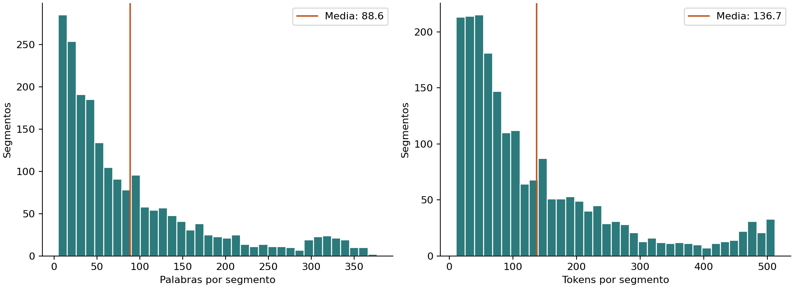
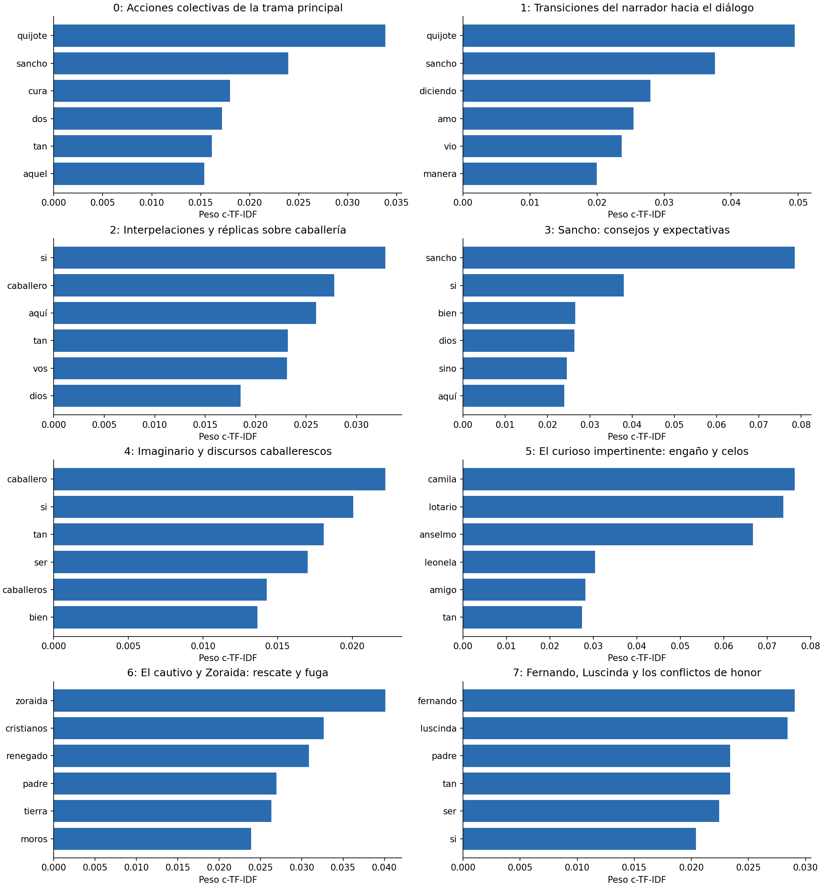
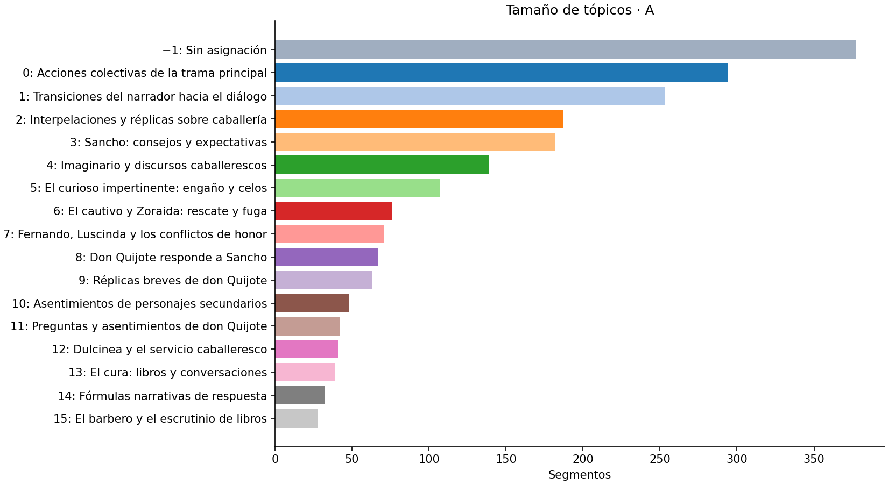
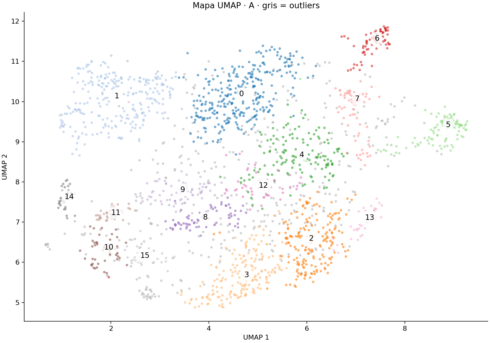
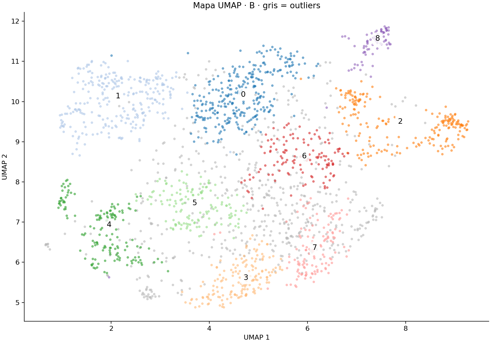
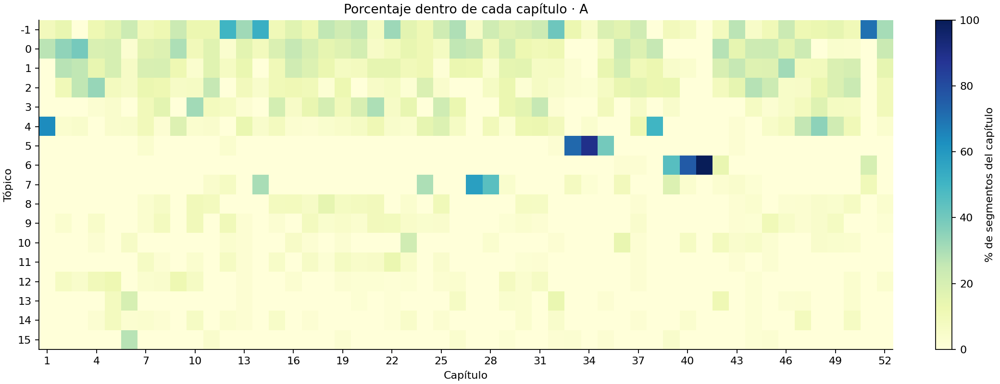

# Tópicos en la primera parte del Quijote

## Corpus y segmentación

Se procesan los 52 capítulos de la primera parte de *Don Quijote de la Mancha* (1605), de Miguel de Cervantes Saavedra,
obtenidos de [Project Gutenberg](https://www.gutenberg.org/ebooks/2000). Se excluyen portadas, prólogos, índice,
títulos de capítulos, licencia y la segunda parte (1615). Se conserva el cierre en verso de la primera parte.
El texto es diferente de las reseñas de Letterboxd del repositorio de referencia.

| Etapa | Número |
|---|---:|
| Párrafos originales | 1980 |
| Párrafos que requieren división por límite de tokens | 75 |
| Segmentos antes de filtros | 2072 |
| Eliminados por menos de cinco palabras | 22 |
| Duplicados eliminados después del filtro de longitud | 4 |
| Segmentos finales | 2046 |

Longitud media: **88.57 palabras** y **136.70 tokens**.
Mínimo: 5 palabras. Máximo: 512 tokens incluyendo prefijo y especiales, con un límite de 512.
Se supera el objetivo de 500 segmentos sin muestreo aleatorio. Cada fragmento conserva su capítulo y párrafo original;
la división nunca une párrafos distintos. Los fragmentos de un párrafo largo no son observaciones independientes.

La asimetría del histograma refleja la convivencia de intervenciones de diálogo breves y párrafos narrativos largos.
El corte a 512 tokens limita la cola; no es evidencia de que el autor escriba párrafos de ese tamaño.
No se aplica truncamiento silencioso al encoder.

## Modelado y justificación

**Unidad de análisis:** un párrafo de la primera parte, con capítulo y párrafo de origen. Solo se dividen párrafos que exceden el límite del encoder; no se mezclan párrafos. Se eliminan segmentos de menos de cinco palabras y duplicados exactos tras normalizar espacios y mayúsculas. No se traducen ni modernizan las palabras. El informe incluye el número final, el embudo de filtros y el histograma de longitudes, de acuerdo con la imagen de Canvas proporcionada.

**Embeddings:** [`intfloat/multilingual-e5-small`](https://huggingface.co/intfloat/multilingual-e5-small), 384 dimensiones. Se elige porque incluye español, está entrenado para semejanza semántica y su límite de 512 tokens permite mantener párrafos más largos que MiniLM de 128 tokens. Para clustering se usa el prefijo `query: `, como recomienda su ficha para tareas distintas de recuperación, y normalización L2. El conteo incluye el prefijo y tokens especiales. No se afirma que sea el mejor encoder para español del Siglo de Oro: esa diferencia de dominio es una limitación que se debe evaluar.

**Preprocesamiento:** el encoder recibe el texto con acentos y contexto. `CountVectorizer` recibe stopwords españolas de [NLTK](https://github.com/nltk/nltk_data/blob/gh-pages/packages/corpora/stopwords.zip), conservadas en `data/stopwords_es.txt`, más una lista explícita de marcadores de diálogo y arcaísmos frecuentes. Se conservan los nombres de los personajes para analizar cómo afectan las agrupaciones.

| Parámetro | A: detalle | B: grupos amplios |
|---|---:|---:|
| HDBSCAN `min_cluster_size` | 25 | 60 |
| HDBSCAN `min_samples` | 5 | 10 |
| `ngram_range` | (1, 1) | (1, 2) |
| `nr_topics` | None | None |
| UMAP `n_neighbors` / `n_components` | 15 / 5 | 15 / 5 |
| UMAP `random_state` | 42 | 42 |

Se comparan dos configuraciones completas, no un experimento que aísle el efecto causal de cada parámetro. Los n-gramas cambian la representación c-TF-IDF; el clustering depende de los embeddings, UMAP y HDBSCAN. No se fuerza un número de tópicos. Las posiciones del mapa UMAP 2D son las mismas en A y B, y no son el espacio de cinco dimensiones donde se ajusta HDBSCAN.

**Outliers:** se conservan como −1. Su porcentaje se calcula sobre todos los segmentos y no se los interpreta como un tópico coherente. Se documenta esta decisión en vez de forzar una asignación que podría ocultar ambigüedad.

**Reproducibilidad:** semilla 42 en Python, NumPy, PyTorch y UMAP, UMAP con un hilo, inferencia CPU y mismo orden de documentos. La identidad numérica entre sistemas operativos y versiones distintas no está garantizada. Los embeddings se vuelven a calcular al ejecutar el notebook; solo se reutilizan los pesos descargados.

## Comparación de las ejecuciones

| Configuración | Tópicos | Outliers | Outliers (%) | Silhouette (coseno) | Diversidad top-10 |
| --- | --- | --- | --- | --- | --- |
| A | 16 | 377 | 18.43 | 0.0539 | 0.65 |
| B | 9 | 522 | 25.51 | 0.0637 | 0.622 |

La silhouette se calcula en los embeddings originales con distancia coseno, solo sobre inliers,
y usa como máximo 2,000 observaciones con semilla 42. Una cifra pequeña indica separación débil en ese espacio,
aunque los grupos puedan ser interpretables. Excluir −1 cambia la población evaluada; no hay etiquetas de referencia.
La diversidad es la proporción de términos distintos entre todos los términos top-10 válidos; A usa unigramas y B también
bigramas, por lo que esta comparación lexical no es completamente equivalente. No es una medida de coherencia semántica.

## Tabla de tópicos y nombres

### Configuración A

| Topic | Nombre_propio | Count | Porcentaje |
| --- | --- | --- | --- |
| -1 | Sin asignación (outliers) | 377 | 18.43 |
| 0 | Acciones colectivas de la trama principal | 294 | 14.37 |
| 1 | Transiciones del narrador hacia el diálogo | 253 | 12.37 |
| 2 | Interpelaciones y réplicas sobre caballería | 187 | 9.14 |
| 3 | Sancho: consejos y expectativas | 182 | 8.9 |
| 4 | Imaginario y discursos caballerescos | 139 | 6.79 |
| 5 | El curioso impertinente: engaño y celos | 107 | 5.23 |
| 6 | El cautivo y Zoraida: rescate y fuga | 76 | 3.71 |
| 7 | Fernando, Luscinda y los conflictos de honor | 71 | 3.47 |
| 8 | Don Quijote responde a Sancho | 67 | 3.27 |
| 9 | Réplicas breves de don Quijote | 63 | 3.08 |
| 10 | Asentimientos de personajes secundarios | 48 | 2.35 |
| 11 | Preguntas y asentimientos de don Quijote | 42 | 2.05 |
| 12 | Dulcinea y el servicio caballeresco | 41 | 2.0 |
| 13 | El cura: libros y conversaciones | 39 | 1.91 |
| 14 | Fórmulas narrativas de respuesta | 32 | 1.56 |
| 15 | El barbero y el escrutinio de libros | 28 | 1.37 |

### Configuración B

| Topic | Nombre_propio | Count | Porcentaje |
| --- | --- | --- | --- |
| -1 | Sin asignación (outliers) | 522 | 25.51 |
| 0 | Acciones colectivas de la trama principal | 294 | 14.37 |
| 1 | Transiciones del narrador hacia el diálogo | 257 | 12.56 |
| 2 | Conflictos amorosos de relatos intercalados | 200 | 9.78 |
| 3 | Sancho: consejos y expectativas | 158 | 7.72 |
| 4 | Fórmulas breves de diálogo | 152 | 7.43 |
| 5 | Don Quijote: réplicas a Sancho y otras respuestas | 136 | 6.65 |
| 6 | Imaginario y discursos caballerescos | 126 | 6.16 |
| 7 | Interpelaciones y réplicas sobre caballería | 123 | 6.01 |
| 8 | El cautivo y Zoraida: rescate y fuga | 78 | 3.81 |

Los CSV `topicos_A.csv` y `topicos_B.csv` contienen `get_topic_info` con nombres propios y porcentajes. Los catálogos
[de A](catalogo_A.md) y [de B](catalogo_B.md) incluyen **tres segmentos íntegros por tópico**; la valoración individual está en el notebook.
Cada segmento puede localizarse en el capítulo y párrafo indicado por `results/segmentos.csv`.

## Análisis de los resultados

**Se elige A como configuración principal para interpretar el contenido.** Distingue *El curioso impertinente* (A5) del conflicto amoroso de Fernando y Luscinda (A7), conserva el grupo del cautivo (A6) y deja fuera menos segmentos. Sus 16 tópicos exigen más lectura que los nueve de B y varios son patrones de estilo. B ofrece una síntesis más corta, pero su mayor silhouette (0.0637 frente a 0.0539) no compensa por sí sola esa pérdida de detalle: ambas cifras indican separación débil en el espacio original. No hay evidencia de que una configuración sea universalmente superior.

B aumenta los outliers de 377 a 522: **145 segmentos más y 7.09 puntos porcentuales**. Exigir grupos más grandes no garantiza mayor cobertura. La tabla de cruces muestra que 209 inliers de A pasan a −1 en B, mientras 64 outliers de A sí reciben grupo en B. Por eso no es correcto describir B como una simple fusión de los grupos de A.

El acuerdo ajustado entre particiones (ARI) es 0.648 incluyendo −1 y 0.911 sobre los 1,460 segmentos que son inliers en ambas. El segundo valor sugiere que buena parte de las asignaciones centrales se conserva, pero excluye precisamente los casos cuya aceptación cambia. Es acuerdo entre configuraciones, no una medida de exactitud.

### Visualización 1: barras de palabras y tamaños

Las palabras de **A5** —Camila, Lotario, Anselmo y Leonela— permiten reconocer *El curioso impertinente*. **A6** combina Zoraida, cristianos, renegado, barca y moros: la lectura de sus ejemplos confirma una historia de cautiverio y fuga. En contraste, A0 y A1 contienen Quijote, Sancho y fórmulas generales que aparecen en muchos episodios. Una barra alta es un peso descriptivo c-TF-IDF, no una probabilidad de pertenencia ni el número de menciones en toda la novela.

A0 tiene 294 segmentos (14.37%) y A1, 253 (12.37%): son los dos grupos mayores y, sin embargo, no son los dos más específicos. El grupo −1 reúne 377 (18.43%) y supera a cualquier tópico individual. El tamaño permite medir cobertura, pero no coherencia. El catálogo conserva los tópicos pequeños para poder discutirlos, en vez de esconderlos tras el gráfico de los ocho más grandes.

En B, «quijote quijote» aparece entre los términos de B4. Al construir c-TF-IDF, BERTopic concatena textos del mismo grupo; un bigrama puede cruzar el límite entre dos documentos después de retirar stopwords. La comprobación da cero ocurrencias de ese bigrama al analizar cada segmento de B4 por separado y seis al concatenarlos. Este es un artefacto de representación: no debe interpretarse como una expresión literaria recurrente. Los n-gramas cambiaron las descripciones, no la geometría de los embeddings usada por HDBSCAN.

### Visualización 2: mapa UMAP de segmentos

En A, el grupo 5 aparece concentrado a la derecha y el 6 en la zona superior derecha, mientras que 0 y 1 ocupan regiones más amplias. A14 forma una pequeña zona compacta a la izquierda: sus ejemplos muestran que corresponde a fórmulas de respuesta y no a un tema literario.

Los mapas usan **las mismas coordenadas** y cambian únicamente el color según A o B. Se observan zonas concentradas y una región más mezclada, coherentes con la coexistencia de relatos específicos y parlamentos comunes a toda la novela. Las fórmulas breves también pueden formar manchas compactas: la cercanía geométrica no las convierte en temas de contenido. En B, varios grupos pequeños de A se agrupan o pasan a gris; la correspondencia se comprueba con la tabla de cruces, no solamente con la imagen.

UMAP 2D puede distorsionar distancias; ni la orientación de los ejes ni la separación visual prueban una oposición literaria. El clustering se entrenó en cinco dimensiones, no sobre estos mapas de dos dimensiones. Los rótulos enlazan con los identificadores de las tablas; los colores son identificadores, sin orden semántico.

### Visualización 3: tópicos a lo largo de los capítulos

La concentración de **A5 en los capítulos 33–35** aporta evidencia contextual: 103 de sus 107 segmentos (96.3%) están en ese tramo. **A6** tiene 67 de sus 76 segmentos (88.2%) en los capítulos 39–41, donde se relata el cautiverio. Esos dos grupos tienen sentido como episodios reconocibles. A0 y A1 se reparten por muchos capítulos, compatible con sus nombres amplios de acciones y transiciones del narrador.

Cada columna está normalizada sobre los segmentos de su capítulo, incluyendo −1. Un capítulo corto y uno largo pueden mostrar el mismo porcentaje con cantidades distintas. La continuidad temporal no prueba por sí sola coherencia, pero ayuda a comprobar que los nombres propuestos coinciden con la ubicación de los ejemplos.

### Tópicos que tienen sentido y agrupaciones que fallan

Los resultados más interpretables son **A5, A6 y A7**: palabras, ejemplos y localización apuntan a relatos identificables. A4 también permite hablar del imaginario caballeresco, aunque incluye reflexiones sobre libros y fantasías de don Quijote. A3 sigue la perspectiva de Sancho, una agrupación más ligada al personaje que a un único asunto.

Los grupos **A10, A11 y A14** tienen medianas de 8, 8.5 y 7 palabras. Sus ejemplos centrales son afirmaciones como «Así es», preguntas cortas o «A lo cual respondió don Quijote». Pasan el mínimo de cinco palabras porque incluyen el marcador de hablante, pero aportan poco contexto temático. En B se concentran en B4, cuya mediana es de ocho palabras. Eliminar duplicados exactos no elimina variantes casi idénticas. Estos grupos se explican por la estructura del diálogo y la longitud, y no se presentan como descubrimientos literarios.

**A12** tiene relación con Dulcinea y el servicio a damas, pero todos sus 41 segmentos pasan a −1 en B; **A13**, centrado en el cura, pierde también sus 39 segmentos. Esto evidencia sensibilidad a los parámetros. Para una mejora posterior convendría comparar la unidad párrafo con una variante que incorpore contexto adyacente a intervenciones muy cortas, dejando explícito que cambiaría la unidad exigida en esta entrega. También podría evaluarse una lista ampliada de conectores frecuentes y una representación que evite bigramas entre documentos. Esos cambios no se aplicaron aquí y no se les atribuye una mejora no medida.

Un ejemplo importante de −1 es **P1-C01-S0001**, el célebre inicio «En un lugar de la Mancha…»: queda sin asignación en ambas configuraciones, aunque es esencial para la novela. Su descripción de la vida cotidiana no forma un grupo denso suficiente. Esto muestra por qué outlier no equivale a texto inútil y justifica conservarlo en los datos y porcentajes.

## Tratamiento de los outliers

A conserva **377 de 2046 segmentos (18.43%)** como −1;
B conserva **522 (25.51%)**. No se eliminan ni se reasignan.
Son una señal de densidad insuficiente o ambigüedad; no prueba de texto malo ni de irrelevancia literaria.
Los catálogos contienen tres ejemplos de −1 por configuración para inspección. Se evita forzar su incorporación a temas
porque cambiaría la cobertura a costa de asignaciones sin validación. Como trabajo posterior se podría probar
`reduce_outliers` con un umbral de coseno, comparar antes/después y revisar manualmente las reasignaciones.
Ese experimento no se ejecutó y sus efectos no se presuponen.

## Límites y fuentes

El español del Siglo de Oro contiene grafías y sentidos distintos del español contemporáneo utilizado por el encoder.
Los nombres propios pueden dominar grupos de personajes y episodios; esto no demuestra el descubrimiento de temas
literarios abstractos como justicia o idealismo. La novela tiene continuidad y relatos intercalados, por lo que los segmentos
no son independientes. Las frecuencias son de segmentos, no de palabras, lectores o toda la obra de Cervantes.
El modelo asigna un solo tópico por fragmento aunque este contenga varias ideas.

La semilla fija controla UMAP, pero las versiones y plataforma también influyen. Las versiones principales están fijadas en `requirements.txt` y la revisión del encoder aparece en `analisis_quijote.ipynb`. La implementación y la interpretación
se elaboraron con asistencia de IA; no existe una evaluación humana independiente ni métricas de exactitud.

Fuentes: [corpus](https://www.gutenberg.org/ebooks/2000),
[encoder E5](https://huggingface.co/intfloat/multilingual-e5-small),
[reproducibilidad de BERTopic](https://maartengr.github.io/BERTopic/getting_started/best_practices/best_practices.html),
[outliers](https://maartengr.github.io/BERTopic/getting_started/outlier_reduction/outlier_reduction.html),
[repositorio consultado](https://github.com/ErikJajan/BERTopic).
